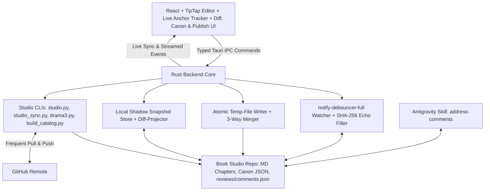

# Book Studio Desktop — UX & Cross-Platform Engineering Plan

> **Goal:** Give writers an intuitive, Google Docs / Scrivener-caliber desktop writing studio on **Windows and Linux** that works directly on top of Book Studio's existing Git, Markdown, and JSON repository structure—with **always-in-sync files**, **resilient anchored comments for Antigravity**, **clear visibility into both writer and agent edits**, **effortless version iteration**, and **world-to-chapter semantic navigation**.

---

## 1. Problem Statement & Design Principles

Book Studio already provides a rigorous multi-agent publishing workflow in [`AGENTS.md`](../AGENTS.md) and [`tools/studio.py`](../tools/studio.py). However, inspecting real projects in this repository (`corporate-castle/standalone/the-hot-potato-of-corporate-castle/` and `wizarding-world/goblin-wars/the-ledger-of-ashes/`) exposes four clear friction points for writers:

1. **Raw Markdown Editing Feels Technical:** Writers want to write and revise directly in clean, well-typeset prose—not stare at `#` headings, `*italics*`, escaped punctuation, or terminal commands.
2. **No Native Comment-to-Agent Loop:** Today, asking specialists (`line_editor`, `canon_keeper`, `character_director`, etc.) to revise a specific passage requires copying quotes into prompts. Writers expect to highlight a passage, leave an anchored margin comment, and have **Antigravity** act on those comments via a dedicated skill—without the comment ever detaching when prose is edited or when phrases repeat in a chapter.
3. **Repository Navigation Does Not Match a Writer's Mental Model:** A single book spans 20+ files across three nested levels (`{universe}/canon.json`, `{universe}/characters/CHAR-*.md`, `{series}/promises.json`, `{book}/brief.md`, `scenes.json`, `knowledge.json`, `manuscript/*.md`, `reviews/gates.json`, `reviews/issues.json`). Navigating those in a code tree breaks creative flow.
4. **Sync, Change Visibility, and Version Iteration Are Opaque:** When writers and Antigravity edit files on disk, writers need files to stay **continuously in sync**, open to the **latest clean version by default**, inspect **exactly what changed** whenever desired, and **compare, iterate, or restore earlier versions** without touching Git CLI commands.

### Six Core Design Principles

1. **Prose First, Repository Beneath:** Real `.md` and `.json` files in the repository remain the single source of truth. There is zero proprietary database lock-in; `python3 tools/studio.py`, Antigravity, `codex`, and `opencode` continue working unchanged.
2. **Always in Sync, Never Destructive:** Bidirectional live sync keeps the UI and disk aligned in real time via atomic writes, filesystem watching, and non-destructive 3-way merge protection.
3. **Clean Default, Radical Change Clarity on Demand:** Chapters always open in **Clean Prose** showing the latest synced version, while **Inline Diff** and **Side-by-Side Compare** are one click away to inspect **writer edits** vs. **agent edits** hunk by hunk.
4. **Effortless Version Iteration:** Automatic local shadow snapshots plus one-click named milestones let writers compare any two drafts, cherry-pick a paragraph back, or restore an older version without Git jargon.
5. **Resilient Anchoring & Clean Manuscript Separation:** Comments and local version snapshots live in sidecar/local storage—never inside `.md` manuscript prose, EPUB/PDF exports, or narration scripts—and anchors automatically update when commented text changes or repeats.
6. **Fast, Native Cross-Platform Feel:** First-class support for **Windows 10/11** and **Linux** (X11 and Wayland) with low memory overhead so local LLMs (Ollama) and local TTS (Drama 3) still have ample headroom.

---

## 2. Recommended Tech Stack & Library Reuse (Windows + Linux)

### Desktop Shell: **Tauri v2** (Rust Backend + OS WebView)

* **Why Tauri v2:**
  * **Small installers & low idle RAM:** ~10–20 MB installers (`.msi` / NSIS on Windows; `.AppImage`, `.deb`, `.rpm` on Linux) and significantly lower RAM footprint than bundling Chromium, leaving system memory free for Antigravity, local models, and TTS engines.
  * **Native filesystem & process power:** Rust gives us safe atomic file writes, debounced recursive file watching (`notify`), fast local diffing/3-way merge (`similar` / `diffy`), Git inspection (`git2`), and lightweight subprocess invocation for `python3 tools/studio.py` (`new`, `check`, `packet`, `build`).
* **Platform Trade-Off & Fallback:**
  * On Linux, Tauri uses WebKitGTK, which can exhibit occasional Wayland/DMABUF quirks on specific GPU drivers (requiring CI smoke checks and `WEBKIT_DISABLE_DMABUF_RENDERER=1` verification).
  * Because ~90% of the application lives in standard React + TypeScript, **Electron** remains a clean drop-in shell fallback behind the same typed IPC boundary if pixel-identical Chromium parity ever outweighs binary size and RAM.

### Frontend & Reusable Libraries

| Layer | Choice | Why Reuse This Library |
| --- | --- | --- |
| **UI Framework** | **React 19 + TypeScript + Vite** | Mature ecosystem, strict schema typing for `book.json`, `scenes.json`, `canon.json`, and `reviews/*.json`. |
| **WYSIWYG Prose Editor** | **TipTap v2 (ProseMirror)** + custom lossless Markdown serializer | ProseMirror's immutable document tree + transaction `Mapping` + `Mark`/`Decoration` system lets **live comment anchors automatically track edits inside the commented text**, preserves cursor position during live external sync updates, and renders inline diffs cleanly. |
| **Optional Source Drawer** | **CodeMirror 6** | Used only when a user toggles "Raw Markdown" or inspects technical files (`AGENTS.md`). |
| **UI Primitives & Layout** | **Radix UI**, **`react-resizable-panels`**, **`@dnd-kit`**, **`cmdk`**, **Lucide React** | Accessible popovers/dialogs, smooth split-reference & diff panes, drag-and-drop chapter reordering (syncing `book.json.chapters`), and `Ctrl+K` / `Cmd+K` universal command palette. |
| **State & Live Sync Cache** | **Zustand** + **TanStack Query** | Zustand manages local UI/diff/version/theme state; TanStack Query caches parsed repo entities and auto-invalidates on Tauri `fs-changed` events. |
| **Instant Repo Search** | **MiniSearch** | Sub-10ms client-side full-text & fuzzy search across chapters, characters, canon rules, and comments. |
| **Diffing, 3-Way Merge & Re-Anchoring** | **`diff-match-patch`** (JS) + **`similar` / `diffy`** (Rust) | Word-level prose diffs for Inline & Side-by-Side views, 3-way merge for concurrent edits, snapshot diff-projection for externally rewritten comments, and fuzzy quote fallback. |
| **Existing Studio CLIs** | **`tools/studio.py`**, **`tools/studio_sync.py`**, **`tools/drama3.py`**, **`tools/narration.py`**, **`tools/build_catalog.py`** | Invoked directly by Rust so structural checks, GitHub push/pull sync, Fish Audio Drama 3 narration, and catalog/EPUB/PDF publishing stay 100% consistent with CLI workflows. |

### High-Level Architecture



---

## 3. Core Writer Experience & Workflows

### A. Always-In-Sync Architecture (Bidirectional Live Sync & 3-Way Merge)

Writers should never wonder *"Did I save?"* or *"Am I looking at an outdated version after Antigravity edited the file?"*

* **Writer → Disk (Continuous Atomic Save):**
  * Typing updates a debounced auto-save queue (~350 ms idle, plus immediate flush on blur or chapter switch), keeping both the `.md` chapter and `reviews/comments.json` anchors synchronized.
  * Rust writes via temporary file + atomic rename (matching `atomic_write` in `tools/studio.py`), keeping the top bar **Live Sync Pill** updated (`Live Sync · Watching repo`, `Saving…`, `External write synced`).
* **Disk / Antigravity → Writer (Live Reload Without Disruption):**
  * `notify-debouncer-full` (150 ms window) watches the entire library directory.
  * **Echo suppression:** Every write initiated by the desktop app records the resulting file's SHA-256 hash in an in-memory ring buffer so our own saves never trigger redundant reloads.
  * When Antigravity (via the comment-addressing skill) or an external tool modifies `.md` or `reviews/comments.json` on disk, open documents update live in place. ProseMirror maps the writer's cursor/selection through the diff, re-projects comment anchors, and lights up modified items in the left navigator with an indicator dot.
* **Concurrent Edit Protection (3-Way Merge):**
  * Every open buffer retains its `base_snapshot` (text + SHA-256). If a disk change arrives while the writer has un-flushed edits:
    * **Non-overlapping edits:** Rust runs a 3-way merge against `base_snapshot`, applies it cleanly, and marks writer vs. agent regions.
    * **Overlapping edits:** Instead of overwriting either side, the editor highlights the exact paragraph with a calm inline conflict card (`Keep Mine` · `Keep External` · `Combine`).
* **Frequent GitHub Sync (`tools/studio_sync.py` & `docs/workspace-sync.md`):**
  * **Auto-Pull (`refresh`):** Runs on app launch, debounced window focus, and configurable background intervals (`1 min`, `2 min`, `5 min`, or `Manual`). Fast-forwards safely (`git merge --ff-only --no-autostash`) and feeds incoming remote edits straight into the live editor and shadow history.
  * **Auto-Push (`save` + `share`):** Commits scoped modified files and pushes to an authorized private draft tracking branch on idle intervals or on **`Pull & Push Now`**, strictly using `tools/studio_sync.py` (never force-pushing or stashing dirty edits).
  * **Public-Remote Safety Guard:** Checks whether `origin` is public (per `docs/workspace-sync.md`). Unpublished drafts default to **Auto-Pull + Local Save** until a private destination is configured or the author explicitly authorizes a public edition release.
  * **Divergence Handling:** If remote advances past local commits, a calm top-bar pill (`Sync paused · Remote ahead`) opens a Side-by-Side reconcile flow rather than failing silently.

### B. Clean Default & Crystal-Clear Change Visibility

* **Clean by Default:** Opening any chapter always shows the **latest synced version in Clean Prose** (Warm Paper, Crisp Light, or Evening Ink dark theme; one-keystroke Focus Mode). Modified paragraphs show only a subtle left-gutter marker (`blue` for writer edits since last milestone, `sage` for recent external/Antigravity updates) so the page stays calm and readable.
* **On-Demand Diff & Attribution:** Writers must easily see **what changed**, **who changed it** (`You` vs. `@line_editor` / `@drafter` / `Antigravity`), and **why**:
  1. **Clean Prose (Default):** Distraction-free reading and writing on the latest version.
  2. **Inline Diff:** Word-level additions (highlighted green/blue) and deletions (red strikethrough) directly inside the chapter prose against any chosen baseline version, with a **`Prev ↑ / Next ↓` Change Stepper** and hunk-level **`Accept`** / **`Reject`** / **`Revert Hunk`** controls.
  3. **Side-by-Side Compare:** Splits the center canvas cleanly—**Left: Baseline Version** (dropdown to select `v1`, `v2`, `v3`…) vs. **Right: Current Live Draft** (continuously editable, with per-paragraph **`Restore from Left`** buttons).
* **Craft-Respecting Markdown Round-Trip:** Serializer honors `.studio/craft.md` and book constraints (e.g., `DEC-CC-0006` in *The Hot Potato of Corporate Castle*: never auto-converting `--` to em dashes, preserving quotation marks, and keeping untouched paragraphs byte-identical so diffs contain zero formatting noise).

### C. Effortless Version Iteration (Two-Layer History Without Git Jargon)

* **Layer 1 — Automatic Local Shadow Snapshots (`.studio-desktop/history/`, gitignored):**
  * Stores content-addressed file blobs + a compact index per file so normal `git log` stays clean and `AGENTS.md` ("do not commit unless authorized") is strictly respected.
  * Automatically records snapshots when external Antigravity edits arrive on disk and at writer idle checkpoints—and serves as the baseline store for diff-projecting comment anchors when external tools rewrite prose.
* **Layer 2 — Named Milestones (Optional Git Commit):**
  * One-click **`Save Version`** lets the writer label a moment (`v5 · Tightened Elliot interview`) and optionally check *"Also create a Git commit"*.
* **Iteration Workflows in the `History` Rail:**
  * Chronological timeline showing `v4 · Current (Live)`, `v3 · Antigravity / @line_editor`, `v2 · Milestone`, `v1 · First Draft`, each with author badge, timestamp, summary, and `+X / -Y words` delta.
  * One-click **`Compare Inline`**, **`Side-by-Side`**, and **non-destructive `Restore`** (restoring `v2` creates `v5` copied from `v2` so earlier work is never lost).

### D. Bulletproof Comment Anchoring (Edited Passages & Duplicate Text)

A naive quote-string anchor breaks in two classic ways:
1. **Editing inside the commented text** causes `"quote"` no longer to match the file, silently dropping the comment.
2. **Repeated phrases** (such as Elliot saying `"I don't recall"` three times in *Chapter One: The Reluctant Steward*, or recurring dialogue tags like `"she said"`) cause a quote lookup to attach to the wrong occurrence.

Book Studio Desktop solves both—and extends commenting to **canon records (`canon.json`, `canon/proposals.json`, `characters/CHAR-*.md`, `scenes.json`, `knowledge.json`)**—with a **2-Layer Hybrid Anchoring Architecture** stored in `{book}/reviews/comments.json`:

* **`target.kind = "markdown"`:** For manuscript chapters, character `.md` sheets, `bible.md`, `brief.md`, and `glossary.md`, uses the **5-signal composite anchor** (`quote`, `original_quote`, `prefix`/`suffix`, `block_index`, `start_offset`/`end_offset`, `occurrence`, `file_sha256`).
* **`target.kind = "record"`:** For structured JSON ledgers (`{universe}/canon.json` `FACT-*`, `canon/proposals.json` `PROP-*`, `scenes.json` `SC-*`, `knowledge.json` `DISC-*`), binds to stable `record_id` + `field` + optional character offset within that field, so comments survive JSON reformatting and proposal-to-canon promotions cleanly.

```json
{
  "schema_version": 1,
  "comments": [
    {
      "id": "CMT-0002",
      "target": { "kind": "markdown", "file": "manuscript/001-the-reluctant-steward.md" },
      "anchor": {
        "quote": "I don't recall",
        "original_quote": "I don't recall",
        "prefix": "\"I received the concern...\"\n\n\"",
        "suffix": " anyone saying that to me.\"",
        "block_index": 11,
        "start_offset": 742,
        "end_offset": 756,
        "occurrence": 2,
        "heading_hint": "# Chapter One: The Reluctant Steward",
        "file_sha256": "a4f9c2..."
      },
      "author": "human",
      "target_role": "line_editor",
      "intent": "revise",
      "body": "Keep this second denial tighter so Elliot starts sounding cornered.",
      "status": "open",
      "created_at": "2026-11-26T21:20:00Z",
      "thread": []
    },
    {
      "id": "CMT-0004",
      "target": {
        "kind": "record",
        "file": "../../canon.json",
        "record_id": "FACT-0005",
        "field": "fact"
      },
      "anchor": {
        "quote": "unblinking stillness paired with surgical, unspinnable truth",
        "original_quote": "unblinking stillness paired with surgical, unspinnable truth",
        "start_offset": 48,
        "end_offset": 108
      },
      "author": "human",
      "target_role": "canon_keeper",
      "intent": "check-canon",
      "body": "Clarify whether Mirror Shield applies only to formal inquiries or also casual 1:1s.",
      "status": "open",
      "created_at": "2026-11-26T21:24:00Z",
      "thread": []
    }
  ]
}
```

The Comments rail offers a quick filter between **`This View`** and **`All (Manuscript + Canon)`**, and clicking any canon comment jumps straight to that `FACT-*` / `PROP-*` card in Canon Vault. Both manuscript and canon comments are processed together by the Antigravity `address-comments` skill.

#### Layer 1: In-Editor Live Position Mapping (Writer Edits)
* Inside TipTap/ProseMirror, every comment is stored as a range mark `(from, to)` identified by `CMT-*` ID—**never** matched by searching the text string while typing.
* Every keystroke emits a ProseMirror transaction whose `tr.mapping.map(from)` / `tr.mapping.map(to)` automatically shifts, expands, or shrinks the mark:
  * **Typing inside or rewording the commented span:** The mark stays attached, and on the 350 ms debounced auto-save the app automatically updates `anchor.quote`, `start_offset`, `end_offset`, `block_index`, `prefix`, `suffix`, `occurrence`, and `file_sha256` in `reviews/comments.json` (preserving `original_quote` and setting an `"Anchor auto-updated"` indicator in the UI).
  * **Duplicate phrases:** Because each mark sits at an exact document position, commenting on the 2nd `"I don't recall"` highlights *only* that span, even if the 1st and 3rd occurrences are identical.
  * **Full span deletion:** If the writer deletes the commented span down to length 0, the comment does not vanish—it degrades gracefully to a **block-pinned / orphaned note** at `block_index` with `original_quote` preserved.

#### Layer 2: 4-Tier Re-Anchoring Waterfall (File Reload & External Antigravity Edits)
When loading from disk or receiving an external file update from Antigravity, the app resolves every comment through four deterministic tiers:

1. **Tier 1 — Exact Offset + Hash Fast Path:** If `file_sha256` matches or the slice at `[start_offset, end_offset]` still equals `quote`, re-attach instantaneously—disambiguating duplicate phrases deterministically by exact coordinates.
2. **Tier 2 — Disambiguated Context Scoring (Shifted Text / Duplicates):** Search all occurrences of `quote` in the file and score each candidate:
   * `prefix` + `suffix` character overlap (**60%** weight)
   * `block_index` / `heading_hint` proximity (**25%** weight)
   * `start_offset` character proximity (**15%** weight), with `occurrence` index as tie-breaker.
   Updates `start_offset`, `end_offset`, `block_index`, `occurrence`, and `file_sha256` automatically.
3. **Tier 3 — Snapshot Diff-Projection (External Rewrites of the Commented Span):** When Antigravity edits or rewrites the commented text itself, the desktop app pulls the prior text matching `anchor.file_sha256` from its local shadow snapshot store, computes a word/character diff `old_text → new_text`, and **projects `[start_offset, end_offset]` through the diff into `[new_start, new_end]`**. It automatically updates `anchor.quote`, offsets, and context in `reviews/comments.json`—surviving even complete rewrites! (If no prior snapshot exists, falls back to `diff-match-patch` bitap fuzzy search near `start_offset`.)
4. **Tier 4 — Block-Pinned / Graceful Orphan Fallback:** If the passage was deleted entirely, pins the comment card to its last known `block_index` with a `"Passage deleted — original quote preserved"` badge and a 1-click **Re-anchor to Selection** action.

### E. Antigravity Comment Workflow (Skill-Driven, No In-App Runner Yet)

* Rather than embedding a separate agent runner inside the desktop app right now, **comments are addressed directly from Antigravity using a dedicated skill** (`.studio/skills/address-comments/SKILL.md`, planned alongside the app).
* **End-to-End Loop:**
  1. Writer highlights a passage (`Ctrl+Alt+M`) → tags specialist (`@line_editor`, `@canon_keeper`, `@character_director`, etc.) → writes note → saved atomically to `{book}/reviews/comments.json` with its 5-signal anchor.
  2. Writer clicks **`Copy for Antigravity`** in the top bar (copies a concise prompt referencing the book and open `CMT-*` IDs) or simply asks Antigravity to address open comments.
  3. Antigravity's skill reads `reviews/comments.json` (plus `tools/studio.py packet`), applies edits to the `.md` files on disk, appends its response to `thread`, and updates `status` (`needs-review` or `resolved`).
  4. The desktop app's `notify` watcher detects the disk write immediately, saves a shadow snapshot, re-projects any modified comment anchors (Tier 3), refreshes the clean latest view, and offers a calm banner to inspect changes in **Inline Diff** or **Side-by-Side**.

### F. Semantic Navigation (World → Series → Book → Entities)

* **Library / Book Switcher:** Top-left dropdown shows covers, stage badges (`brief` → `production`), word counts, and live change dots across universes (`corporate-castle`, `wizarding-world`, `bellwether-reach`, `garbanzo-family`).
* **Writer-First Left Navigator:**
  * **Manuscript:** Chapters ordered from `book.json.chapters`, drag-to-reorder, word counts, open comment badges, live change dots, and **`+ New Chapter`**.
  * **Story Craft:** `Book Brief`, `Outline & Scene Cards` (`scenes.json`), `Style & Voice`, `Story Threads` (`threads.json`).
  * **World & Lore** (auto-resolving `{universe}/` and `{series}/`): `Characters` (`characters/CHAR-*.md` as structured Character Sheets), `World Bible & Glossary`, `Canon Vault` (`canon.json` + `canon/proposals.json` with 1-click promotion), `Timeline`, `Knowledge & Spoilers` (`knowledge.json` disclosure matrix).
  * **Editorial & Production:** `Editorial Gates & Issues` (`reviews/gates.json` & `issues.json`), `Publish & Audio` (edition builder, catalog checks, and optional Drama 3 narration).
  * **Studio Internals** (collapsed by default): `handoff.md`, `tasks.json`, `decisions.md`, `AGENTS.md`.
* **Right Story Companion Rail (`Comments` | `History` | `Context` | `Sync`) + Split Reference + `Ctrl+K`:**
  * `Sync` tab displays live filesystem watcher status, frequent GitHub push/pull controls (`tools/studio_sync.py`), recent external sync events, and the 1-click **Copy Prompt for Antigravity** card.

### G. Optional Publishing & Audio Narration Studio

Publishing and read-aloud audio are strictly **opt-in ("if requested")** and preserve Book Studio's separation between source prose and downstream editions (`docs/publishing.md`, `docs/narration.md`).

* **Edition Build & Publishing (`tools/studio.py`, `tools/build_catalog.py`):**
  * Runs `python3 tools/studio.py check`, `studio.py build`, book EPUB/PDF packaging scripts, and `python3 tools/build_catalog.py validate` / `build`.
  * Enforces an explicit **Publish Authorization Checklist** before touching `publications/` or `site/`: privacy status check from `brief.md` (preventing accidental release of private drafts), SHA-256 artifact verification, and proof that **0 comment or performance tags** leaked into any EPUB or PDF.
  * When authorized, pushes the release commit via `tools/studio_sync.py` so `.github/workflows/pages.yml` deploys GitHub Pages cleanly.
* **Optional Audio Builder (Fish Audio Drama 3 via `tools/drama3.py` & `tools/narration.py`):**
  * Disabled by default for drafts unless the author explicitly enables read-aloud audio for the book.
  * Guided step-by-step UI wrapping existing CLI tools:
    1. **Preflight (`drama3.py doctor`):** Verifies local `audiocpp_cli`, Drama 3 GGUF (Vulkan), `ffmpeg`, and `faster-whisper` ASR availability.
    2. **Prepare (`prepare-chapters` / `prepare-pages`):** Splits ordered chapters or `production/narration/script.md` into word-exact segments without touching manuscript files.
    3. **Pilot & Full Render (`render` + `split-retake`):** Lets the writer test one pilot segment/page before rendering the full book.
    4. **Verify & Package (`check` + `assemble-chapters` / `narration.py`):** Runs WPM, silence, and ASR transcript checks, packages mono MP3s into `site/audio/<book-id>/` or `narration/<book-id>/`, and verifies `"Built with Fish Audio"` attribution and cast voice provenance (`cast.json`).

---

## 4. Phased Delivery Roadmap (~10–12 Weeks)

| Phase | Timeline | Deliverables |
| --- | --- | --- |
| **Phase 1: Core Writing & Live Sync Shell** | Weeks 1–3 | Tauri v2 shell + GitHub Actions builds (Windows `.msi`/NSIS, Linux `.AppImage`/`.deb`); repo indexer; semantic sidebar; TipTap WYSIWYG editor defaulting to **Clean** latest view with lossless Markdown round-trip; atomic auto-save; `notify` live watcher with echo suppression; `Ctrl+K`; Warm/Light/Dark themes + Focus Mode. |
| **Phase 2: Hybrid Anchors, Versions & GitHub Sync** | Weeks 4–6 | Local shadow snapshot store (`.studio-desktop/history/`) + named milestones; Inline Diff & Side-by-Side Compare with writer vs. external attribution; non-destructive restore; `{book}/reviews/comments.json` supporting both Markdown 5-signal anchors (Layer 1 live mapping + Layer 2 4-tier re-anchoring) and **canon/JSON record anchors**; 3-way merge conflict UI; frequent GitHub push/pull wrapper around `tools/studio_sync.py`; **Copy for Antigravity** skill handoff + `.studio/skills/address-comments/SKILL.md`. |
| **Phase 3: World, Characters & Story Craft Views** | Weeks 7–9 | Structured Character Sheets (`characters/CHAR-*.md`); Canon Vault with inline commenting + proposal acceptance workflow; Scene Board (`scenes.json`); Knowledge & Spoilers matrix (`knowledge.json`); drag-and-drop chapter ordering (`book.json`); contextual entity hover-peek & Split Reference pane. |
| **Phase 4: Publish, Drama 3 Audio & Release Polish** | Weeks 10–12 | Editorial Gates & Issues dashboard (`reviews/gates.json`, `issues.json`); optional **Publish & Audio Studio** (`studio.py check`/`build`, `build_catalog.py`, `drama3.py`, `narration.py` with privacy & tag-isolation guards); accessibility audit; Windows 11 + Ubuntu/Fedora smoke verification. |

---

## 5. Key Risks, Mitigations & Verification Strategy

| Risk | Mitigation | Verification |
| --- | --- | --- |
| **Markdown round-trip diff noise** | Custom ProseMirror serializer preserving untouched blocks byte-for-byte and honoring `.studio/craft.md` (no auto em-dashes). | Golden round-trip test suite running open → untouched save → byte-identical check on `the-ledger-of-ashes` (22 chapters) and `the-hot-potato-of-corporate-castle`. |
| **Comment detachment on edited, duplicate, or canon text** | Layer 1 live `(from, to)` ProseMirror mapping + Layer 2 5-signal composite anchor with `prefix`/`suffix`/`block_index`/`occurrence` scoring and shadow-snapshot diff-projection, plus `record_id` anchors for `canon.json`. | Automated tests covering: editing inside a highlight, rewriting via external disk write, deleting a span, commenting on the 2nd of 3 identical `"I don't recall"` lines, and commenting on `FACT-*`/`PROP-*`. |
| **Watcher feedback loops** | Record SHA-256 of app-initiated writes in an echo-filter cache before atomic rename; debounce external events at 150 ms. | Integration test writing from app + simulated Antigravity skill edits simultaneously. |
| **Accidental public push of private drafts or Git divergence** | Reuse `tools/studio_sync.py` strict parent/remote checks; default unpublished books to pull-only on public `origin` and surface divergence in Side-by-Side reconcile UI. | Integration tests on public vs. private tracking branches and non-fast-forward remote updates. |
| **Concurrent writer + Antigravity edits** | Per-file `base_snapshot` + Rust 3-way merge; non-overlapping merges apply cleanly, collisions show inline `Keep Mine` / `Keep External` / `Combine`. | Unit & UI tests covering disjoint paragraph edits and overlapping sentence collisions. |
| **Linux WebKitGTK rendering quirks** | Test Wayland + X11 across Ubuntu LTS and Fedora in CI; isolate WebView APIs behind typed Tauri IPC so Electron remains a clean fallback. | Automated headless/UI smoke runs on Windows 11 and Linux (with & without `WEBKIT_DISABLE_DMABUF_RENDERER=1`). |
